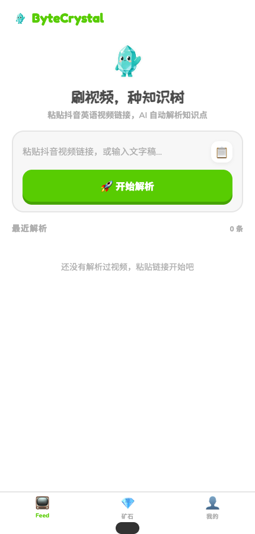

# LinguaTree

个人英语学习原型：视频或文字稿 → 知识点 → 知识图谱、闪卡、问答和迁移练习。



## 两种明确分开的运行模式

- **`APP_MODE=demo`（默认）**：用于作品集的只读虚构示例。三组课程、解析内容、练习参考答案和学习进度都预先写在 `src/demo/snapshot.json`，不代表真实用户或真实视频。不会打开个人 SQLite 文件，不加载个人学习服务，不下载媒体，不调用模型。
- **`APP_MODE=personal`（明确启用）**：保留原有交互式学习功能，使用自己的 SQLite 数据库和模型配置。所有获准访问者仍共用 `default` 用户；这不是多用户服务，知道口令的人能查看和修改同一份个人数据，也能消耗模型额度。

切换到 demo 不迁移、清空或覆盖旧数据。即使误留下 `DB_PATH`、模型密钥或下载配置，demo 也不使用它们。演示建议单独部署，只配置访问参数；不要将真实数据库、`.env` 或密钥放进前端或 Git。

## 本地启动只读演示

需要 Node.js 22 或更高版本。

```bash
npm ci
npm --prefix frontend ci
cp .env.example .env
npm run build:frontend
npm start
```

打开 <http://127.0.0.1:3000>。无需模型密钥、ffmpeg、Python 或数据库迁移。页面会标注只读示例，可以浏览课程、图谱、讲解、闪卡和预生成参考答案。解析、评分、标签编辑、复习提交等操作不开放。

只读约束在服务端实施：任何非 GET/HEAD 请求均返回 403，API 只挂载显式允许的固定示例读取接口。原本可能生成内容的 deepen、flashcards、freeform、migration GET 在 demo 中只读取快照；未知 ID 和未列出的路径返回 404，不回退到个人服务。

前端热更新：`npm run dev` 启动后端，另开终端执行 `npm --prefix frontend run dev`。Vite 将 `/api` 转发至本机后端，并保留浏览器访问的 Host；本机开发时 `PUBLIC_ORIGIN` 留空，或明确设置为当前 Vite 来源。

## 分享演示与访问保护

默认 `HOST=127.0.0.1`，仅监听本机。设置 `DEMO_PASSWORD` 后，页面和 API 都需要 HTTP Basic；用户名固定为 `learner`。生产模式或对外监听时，缺少口令会拒绝启动，已设置的口令至少需要 24 个字符。

生成强随机口令：

```bash
node -e "console.log(require('node:crypto').randomBytes(24).toString('base64url'))"
```

对外部署配置：

```text
APP_MODE=demo
NODE_ENV=production
HOST=0.0.0.0
DEMO_PASSWORD=<自行生成的随机口令>
PUBLIC_ORIGIN=https://your-demo.example.com
```

`PUBLIC_ORIGIN` 填浏览器实际访问的 HTTPS 来源（协议、主机和可选端口，无路径/查询），尤其是 HTTPS 反向代理部署。本机同源服务可留空。应用不信任客户端提供的 `X-Forwarded-Host`/`X-Forwarded-Proto` 来决定可信来源。HTTPS 必须由托管平台或反向代理提供，不能仅把 `PUBLIC_ORIGIN` 写成 https 就获得加密。

从作品集等外部网站点击页面链接，可以进入口令验证；跨站或同站点但不同来源的 API 请求仍被拒绝。缺少 Fetch Metadata 的浏览器/命令行 API 客户端需要提供与公开来源匹配的 `Origin` 或 `Referer`；例如本地 API 脚本使用 `Origin: http://127.0.0.1:3000`。`/health` 只返回不敏感的健康状态，保持公开。

HTTP Basic 没有独立用户会话、退出或单人撤权；浏览器可能缓存凭据。演示后关闭独立浏览器会话，需要撤销分享权限时轮换口令并重启/重新部署服务。只读示例不会保存访客学习进度。

Docker/Render 默认启用 demo，Express 同源提供页面和 API，demo 无需持久化磁盘。现有 `vercel.json` 的独立静态托管无法保护 HTML；请以这里的 Express 同源部署为准，不要将“静态站已部署”等同于“整站已受保护”。部署和外网浏览器验证需要另行进行。

## 保留个人交互模式

在私有的本机或独立部署中明确设置 `APP_MODE=personal`。可在 `.env` 指定 `DB_PATH`；不指定时沿用 `src/db/linguatree.db`，父目录需预先存在。

```bash
APP_MODE=personal npm run migrate
APP_MODE=personal npm start
```

首次个人模式启动会初始化 schema。demo 下运行 `npm run migrate` 仅说明无需迁移，不打开数据库。

视频处理另需 ffmpeg、Python 3、相应 Python `requests`/`dashscope` 依赖，以及支持平台下载的 yt-dlp。根据 `.env.example` 配置 `OPENAI_API_KEY`/`OPENAI_BASE_URL`、`ASR_PROVIDER` 和必要的 `DASHSCOPE_API_KEY`；实际调用会消耗对应服务的额度。部署个人模式需持久化 SQLite 数据目录。

个人模式仍是原型，未在本次改动中增加多用户隔离、完整下载目标限制、模型预算或请求配额。不要将个人模式口令广泛分享，也不要存放多人私密学习记录。本次安全演示通过完全不挂载这些交互接口来隔离上述风险。

## API 与源码

`GET /api/info` 返回 `mode`、`readOnly` 和 `dataset`，前端据此显示能力。demo 返回 `read-only-demo` / `true` / `fictional-pregenerated`，personal 返回 `single-user-personal` / `false` / `null`。没有注册登录或 JWT 账户接口。

```text
frontend/          React 前端与素材；只读模式有单独的练习预览
src/demo/          独立的固定示例快照与 GET 路由
src/routes/        仅 personal 挂载的交互 API
src/services/      仅 personal 使用的学习流程、下载及 AI 服务
src/middleware/    访问保护与个人共享用户上下文
src/db/            仅 personal 打开的 SQLite schema 与初始化
public/            构建生成的前端产物
test/             隔离访问/只读演示/个人兼容回归测试
```

## 测试

```bash
npm test
```

先构建前端，再运行后端及前端回归。测试使用临时目录和虚构数据，不读取开发者 `.env` 或个人数据库，不调用真实模型。demo 测试还设有模块和出站 IO 禁用检查，确保个人数据库、生成服务、下载与网络调用不会进入演示链路。检查外部页面导航、口令保护、来源校验、所有写方法、原有生成型 GET、固定读取不变，以及 personal 模式基本读写兼容。CI 执行同一命令。

`test/test_asr_llm.mjs` 和 `test/test_ocr_vlm.mjs` 是手动模型诊断脚本，需要本地音视频和密钥，会调用外部服务，不属于默认测试。
